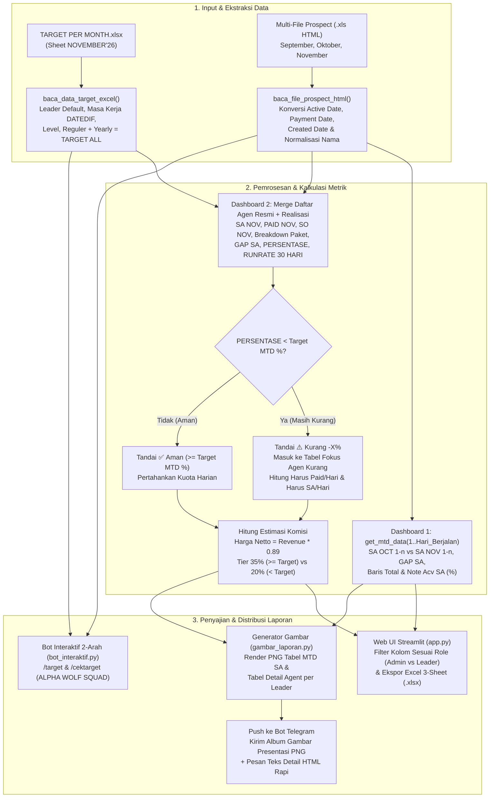

# Product Requirements Document (PRD)
## Sistem Cerdas Dashboard Performa, Proyeksi Target Harian, Perhitungan Komisi & Integrasi Bot Telegram Telesales ISP

| Atribut Dokumen | Detail |
| :--- | :--- |
| **Nama Produk / Sistem** | Sistem Cerdas Dashboard Telesales ISP — Tracking MTD SA, Kuota Harian (Paid/SA/SO), Perhitungan Komisi & Bot Telegram |
| **Lokasi Proyek** | `D:\Skripsi_Komisi_Telesales` |
| **Platform** | Multi-Platform: Web Dashboard (`Streamlit`), Bot Interaktif & Notifikasi (`Telegram Bot API`), dan Aplikasi Desktop (`CustomTkinter`) |
| **Teknologi Utama** | Python 3.12, Streamlit, Pandas, NumPy, Pillow (PIL), Requests, pyTelegramBotAPI (`telebot`), OpenPyXL, CustomTkinter |
| **Arsitektur Kode** | Modular & Object-Oriented Programming (`app.py`, `gambar_laporan.py`, `bot_interaktif.py`, `main.py`, `logic_komisi.py`) |
| **Status Dokumen** | **Versi 3.0 (Final — Edisi Sinkronisasi Skripsi)** |
| **Tanggal Pembaruan** | 9 November 2026 |

---

## 1. Latar Belakang & Rumusan Masalah (Product Overview)

Dalam operasional divisi **Telesales ISP (Internet Service Provider)**, evaluasi kinerja penjualan (*Sales Active / SA*), pengawasan pencapaian target berjalan (*Month-to-Date / MTD*), perhitungan komisi bulanan agen, serta pendistribusian laporan harian ke setiap tim masih menghadapi sejumlah kendala apabila dilakukan secara manual menggunakan *spreadsheet*:

1. **Fragmentasi Data Lintas Bulan**: File ekspor prospek dari sistem CRM (`list_prospect September.xls`, `list_prospect Oktober.xls`, `list_prospect November.xls`) berformat tabel HTML di dalam ekstensi `.xls`. Pelanggan yang mendaftar (*Created Date*) pada bulan sebelumnya sering kali baru aktif (*Active Date*) pada bulan berjalan, sehingga seluruh file lintas bulan harus digabungkan dan disaring secara presisi berdasarkan **`Active Date`**.
2. **Ketidakakuratan Perbandingan Performa Antar-Bulan (*Month-to-Date*)**: Membandingkan capaian bulan berjalan (misal tanggal 1–8 November) dengan total 1 bulan penuh bulan lalu (Oktober) menghasilkan evaluasi yang bias. Diperlukan pemfilteran **Apple-to-Apple MTD** pada rentang tanggal yang persis sama (`1 s/d hari_berjalan`).
3. **Keterlambatan Deteksi Agen di Bawah Target Berjalan (*Under-Target Agents*)**: Team Leader membutuhkan visibilitas instan terhadap **Target Persentase Berjalan (`MTD %`)** (misal pada hari ke-8 dari 30 hari kerja, target berjalan adalah `27%`) untuk mengetahui siapa saja agen yang persentasenya masih kurang, serta **berapa Paid per hari** dan **berapa SA per hari** yang wajib dikejar di sisa hari kerja.
4. **Kerahasiaan Struktur Target (*Role-Based Access Control*)**: Rincian pembagian `Target Reguler` dan `Target Yearly` bersifat internal manajemen (**Admin**), sedangkan **Leader / Agen** hanya boleh melihat **`Target Total` (`TARGET ALL = Reguler + Yearly`)** beserta kuota harian/mingguan yang harus dicapai.
5. **Komunikasi Laporan Harian ke Grup Telegram**: Pengiriman rincian teks panjang ke grup Telegram sering kali sulit dibaca sekilas oleh manajemen maupun agen, sehingga dibutuhkan **Gambar Presentasi Laporan (`.png`)** bergaya tabel laporan resmi perusahaan yang dikirim otomatis bersama rincian teks yang rapi.

### Tujuan Utama Sistem
Membangun ekosistem aplikasi terintegrasi berbasis **Web Dashboard (Streamlit)**, **Generator Gambar Presentasi Otomatis (Pillow)**, **Bot Telegram Dua Arah (pyTelegramBotAPI)**, dan **Aplikasi Desktop (CustomTkinter)** yang mengotomatisasi:
- Ekstraksi dan penggabungan multi-file prospek CRM (`.xls` HTML) serta file target multi-sheet (`TARGET PER MONTH.xlsx`).
- Analisis perbandingan **Summary MTD SA per Sales Leader** secara *Apple-to-Apple*.
- Perhitungan **Detail Agent, Breakdown Paket (`3 Monthly`, `Monthly`, `Semesterly`, `Yearly`), Evaluasi Status Persentase terhadap Target MTD (`27%`), Proyeksi Runrate 30 Hari, Kuota Wajib `Harus Paid / Hari` & `Harus SA / Hari`, serta Estimasi Komisi Final (Tier 35% vs 20% setelah potong PPN 11%)**.
- Pengiriman **Gambar Presentasi Laporan (`.png`) + Pesan Teks HTML Rapi** langsung ke grup/personal Telegram serta layanan perintah interaktif (`/target`, `/cektarget`, `/id`) dengan *Data Access Control*.

---

## 2. Arsitektur Modul & Struktur File Proyek

```text
D:\Skripsi_Komisi_Telesales\
├── app.py                        # [MODUL 1] Web Dashboard Utama (Streamlit): MTD SA, Detail Agent, Kuota Harian, Tab Harian, AI Chatbot & Push Telegram
├── gambar_laporan.py             # [MODUL 2] Generator Gambar Presentasi Laporan (Pillow PNG): Tabel MTD SA & Tabel Detail Agent per Leader
├── bot_interaktif.py             # [MODUL 3] Layanan Bot Telegram Interaktif 2-Arah (ALPHA WOLF SQUAD) dengan Data Access Control
├── main.py                       # [MODUL 4] Aplikasi Desktop GUI (CustomTkinter Dark Mode) — Class AplikasiKomisiTelesales
├── logic_komisi.py               # [MODUL 5] Mesin Pemrosesan Data & Perhitungan Komisi Desktop (baca_file_excel_fleksibel, siapkan_df_target, hitung_komisi)
├── TARGET PER MONTH.xlsx         # Dataset Master Target Bulanan Agen & Struktur Tim (Multi-Sheet: NOVEMBER'26, dll.)
├── data_target.xlsx              # Dataset Target Total Eksklusif Tim ALPHA WOLF SQUAD (Sinkronisasi Bot Interaktif)
├── list_prospect September.xls   # Dataset Transaksi Prospek CRM Bulan September (Format HTML .xls)
├── list_prospect Oktober.xls     # Dataset Transaksi Prospek CRM Bulan Oktober (Format HTML .xls)
├── list_prospect November.xls    # Dataset Transaksi Prospek CRM Bulan November (Format HTML .xls)
├── list_prospect Nov.xls         # Salinan Sinkronisasi Prospek Bulan Berjalan
├── jalankan_semua.bat            # Script 1-Klik: Menyalakan Bot Telegram + Web Dashboard Streamlit secara bersamaan
├── jalankan_streamlit.bat        # Script 1-Klik: Menyalakan Web Dashboard Streamlit (http://localhost:8501)
├── jalankan_bot.bat              # Script 1-Klik: Menyalakan Bot Telegram Interaktif
├── jalankan_aplikasi.bat         # Script 1-Klik: Menyalakan Aplikasi Desktop CustomTkinter
├── requirements.txt              # Daftar dependensi pustaka Python proyek
├── PRD.md                        # Dokumen Spesifikasi Kebutuhan Produk (Product Requirements Document)
└── README.md                     # Dokumentasi ringkas penggunaan sistem
```

---

## 3. Target Pengguna & Hak Akses (*User Persona & Role-Based Access Control*)

| Role Pengguna | Cakupan Akses Data (*Data Scope*) | Visibilitas Kolom Target | Fitur Utama yang Digunakan |
| :--- | :--- | :--- | :--- |
| **1. Admin / Manajemen Operasional** | **Semua Sales Leader** (Seluruh Tim Telesales) | Melihat rincian lengkap: **`TARGET ALL`**, **`Reguler`**, dan **`Yearly (Target)`** | Evaluasi lintas tim (11 Leader), rekap MTD SA nasional, unduh laporan multi-sheet `.xlsx`, dan broadcast gambar presentasi seluruh leader ke Telegram. |
| **2. Sales Leader / Supervisor** | **Tim Leader Terpilih** (misal: *Yovi Arian*, *Fahrul Amrin*, *Firliansyah*, *Tika Saraswati*, *Yudha Irawan*, dll.) | Hanya melihat **`TARGET ALL` (`Target Total`)** *(Kolom `Reguler` & `Yearly` disembunyikan)* | Memantau agen di timnya yang persentasenya masih di bawah Target MTD (`< 27%`), memantau kuota `Harus Paid / Hari` & `Harus SA / Hari`, dan mengirim laporan tim ke grup Telegram. |
| **3. Agen Telesales (*ALPHA WOLF SQUAD*)** | **Anggota Tim Terdaftar** (`Data Access Control` via `isin(tim_alpha_wolf)`) | Hanya melihat **`Target Total`** (Bulanan, Mingguan, Harian) | Mengecek target & kekurangan kuota harian/mingguan melalui perintah `/target` dan `/cektarget [nama]` di Bot Telegram. |
| **4. Tim Keuangan (*Finance*)** | Seluruh Agen Aktif | `Target_Bulan_Ini` (`Target Total`) | Menghasilkan rekap pencairan komisi bersih (`Harga Netto * 35%` atau `20%`) ke file `Laporan_Komisi_Final.xlsx`. |

---

## 4. Kebutuhan Fungsional (*Functional Requirements*)

### 4.1. Modul Autentikasi Portal Login Multi-Role & Pengaturan Parameter (`app.py`)
- **FR-00 (Portal Login Multi-Role & Session Management)**: Menyediakan halaman login eksekutif sebelum masuk ke dashboard utama (`tampilkan_halaman_login` & `verifikasi_login_kredensial`) yang mendukung 4 role pengguna:
  1. **`Admin`** (`admin` / `admin123`): Akses penuh seluruh Sales Leader dan rincian `TARGET ALL`, `Reguler`, serta `Yearly (Target)`.
  2. **`Finance`** (`finance` / `finance123`): Akses seluruh Sales Leader beserta Kartu Ringkasan Finansial (`Total Revenue Kotor`, `Total Harga Netto Potong PPN 11%`, dan `Total Estimasi Komisi`).
  3. **`Leader`** (`yovi`, `fahrul`, `firli`, `tika`, `yudha`, `anis`, `eka`, `rezky`, `tiara`, `jarot`, `alfian` / `leader123`): Mengunci tampilan khusus pada tim Sales Leader yang bersangkutan serta menyembunyikan rincian `Reguler` & `Yearly` (hanya menampilkan `TARGET ALL`).
  4. **`Agen`** (nama depan/lengkap seluruh agen di `TARGET PER MONTH.xlsx` / `agen123`): Menampilkan **Kartu Performa & Kuota Harian Pribadi** (`Target Total Bulanan`, `Realisasi SA/Paid/SO`, `Wajib Paid / Hari`, `Wajib SA / Hari`, dan `Estimasi Komisi Pribadi`).
  - Dilengkapi tab **Akses Cepat per Role (Mode Demo / Sidang Skripsi)** serta tombol **Logout / Ganti Akun** di Sidebar.
- **FR-01 (Kontrol Role & Parameter Waktu)**: Sidebar menyediakan kartu profil pengguna aktif, switcher role cepat, pemilih nama Sales Leader, input `Bulan Lalu (OCT)`, `Bulan Ini (NOV)`, `Tahun (2026)`, `Total Hari Bulan Ini (30)`, `Hari Berjalan Saat Ini (8)`, `Rasio Target Paid per 1 SA (1.25)`, serta input nama sheet target (`NOVEMBER'26`).
- **FR-02 (Multi-File Prospect Uploader & Auto-Fallback)**: Mendukung pengunggahan banyak file prospek sekaligus (`accept_multiple_files=True` untuk `.xls` HTML / `.xlsx`) menggunakan `pd.read_html(f, header=0)[0]` dan menggabungkannya (`pd.concat`). Jika pengguna belum mengunggah file secara manual, sistem otomatis memuat `TARGET PER MONTH.xlsx` serta ketiga file prospek (`September`, `Oktober`, `November`) di direktori proyek.
- **FR-03 (Ekstraksi Daftar Agen Resmi & Masa Kerja `DATEDIF`)**: Membaca blok tim pada `TARGET PER MONTH.xlsx` mulai baris ke-12 (`skiprows=11`), mengekstrak `Leader_Default`, `Nama Agent`, `Masa Kerja` (dihitung otomatis dengan logika `DATEDIF` Excel terhadap tanggal laporan menjadi format `X Tahun Y Bulan`, `New Joiner`, atau `126 Tahun 10 Bulan` untuk `Vacant`), `Level`, `Target Reguler`, `Target Yearly`, dan `TARGET ALL = Reguler + Yearly`.
- **FR-04 (Pembersihan & Normalisasi Nama)**: Menormalisasi variasi penulisan nama agen dan leader menggunakan kamus alias (`ALIAS_NAMA_AGEN`, `TEAM_EXCEL_KE_LEADER`, dan pemetaan sub-tim `AGEN_TOMMY_KE_FIRLY`) serta membuang baris tanpa nama agen (`NaN`) agar tidak muncul entri kosong (`👤 ** (-)`).

### 4.2. Modul Dashboard 1 — Summary MTD SA per Sales Leader (`app.py`)
- **FR-05 (Filter Apple-to-Apple MTD)**: Fungsi `get_mtd_data(df, bulan, tahun, hari_berjalan)` menyaring transaksi yang memiliki `Active Date` pada bulan dan tahun terpilih serta `day <= hari_berjalan`.
- **FR-06 (Tabel & Indikator Summary MTD SA)**: Menghitung jumlah Sales Active bulan lalu (`SA OCT 1-8`) dan bulan ini (`SA NOV 1-8`) per Sales Leader, menghitung `GAP SA = SA NOV - SA OCT`, mengurutkan dari `GAP SA` tertinggi ke terendah, menyembunyikan leader tanpa aktivitas (`0` di kedua bulan), serta menambahkan baris **`Total`** dan indikator **`Note Acv SA`** (`↓ -9%`).

### 4.3. Modul Dashboard 2 — Detail Agent, Kuota Harian & Breakdown Komisi (`app.py`)
- **FR-07 (Banner Target Persentase Berjalan / MTD)**: Menampilkan banner maroon **`TARGET | {hari_berjalan}-{Bulan}-{Tahun} | {target_persen_mtd}%`** di bagian atas tabel, di mana `target_persen_mtd = ROUND((hari_berjalan / total_hari) * 100, 0)%`.
- **FR-08 (Agregasi Performa & Breakdown Paket per Agen)**: Menggabungkan (*Left Join*) daftar agen resmi dari `df_target` dengan realisasi bulan berjalan (`SA NOV`, `PAID NOV`, `SO NOV`), rincian tipe paket (`3 Monthly`, `Monthly`, `Semesterly`, `Yearly`), serta `Total Revenue` (`sum(Service Price)`).
- **FR-09 (Urutan Leader & Agen Sesuai Standar Perusahaan)**: Mengurutkan blok Sales Leader berdasarkan persentase pencapaian tim tertinggi, dan di dalam setiap Sales Leader mengurutkan agen berdasarkan `PERSENTASE` tertinggi lalu `SA NOV` tertinggi (dengan baris `Vacant` ditempatkan di bagian paling bawah blok tim).
- **FR-10 (Evaluasi Status Persentase & Kuota Harian `Paid/Hari` dan `SA/Hari`)**:
  - Menambahkan kolom **`STATUS PERSENTASE`** yang menandai agen dengan capaian di bawah target berjalan (`⚠️ Kurang -X% (< 27%)`) vs agen yang sudah aman (`✅ Aman (>= 27%)`).
  - Menambahkan kolom **`Harus Paid / Hari`** dan **`Harus SA / Hari`** untuk menunjukkan kuota harian yang wajib dicapai agen di sisa hari kerja agar mencapai 100% target bulanan.
- **FR-11 (Tabel Fokus Agen yang Secara Persentase Masih Kurang)**: Menampilkan tabel khusus di bawah Dashboard 2 yang menyaring hanya agen dengan `PERSENTASE < target_persen_mtd`, lengkap dengan informasi `SA NOV Saat Ini`, `PAID NOV Saat Ini`, `Target MTD (SA)`, `Kurang vs MTD`, `Sisa SA ke 100%`, `Harus Paid / Hari`, `Harus SA / Hari`, dan `Target Mingguan (Paid | SA)`.
- **FR-12 (Ekspor Multi-Sheet Excel & CSV)**: Menyediakan tombol unduh `.xlsx` (berisi 3 sheet: `Summary_MTD_SA`, `Detail_Target_Agent`, dan `Agen_Kurang_Persentase`) serta tombol unduh `.csv`.

### 4.4. Modul Gambar Presentasi Laporan & Pengiriman Bot Telegram (`gambar_laporan.py` & `app.py`)
- **FR-13 (Render Otomatis Gambar Presentasi PNG)**: Fungsi `buat_semua_gambar_laporan()` di `gambar_laporan.py` merender tabel laporan beresolusi tinggi menggunakan pustaka **Pillow (PIL)**:
  - Gambar 1 (`01_MTD_SA_1-8_NOV_2026.png`): Tabel **MTD SA — Ringkasan Pencapaian Leader** lengkap dengan pewarnaan merah pada `GAP SA` negatif, baris `Total`, dan `Note Acv SA`.
  - Gambar 2..N (`02_Detail_Agent_<Leader>.png`): Tabel **Detail Agent per Sales Leader** lengkap dengan banner maroon `TARGET | Tanggal | %`, grup header `BREAKDOWN PAKET` (`M`, `3M`, `SEM`, `Y`) dan `KUOTA WAJIB / HARI` (`PAID / HARI`, `SA / HARI`), highlight kuning pada kuota harian agen yang masih kurang, highlight kuning pada baris `Vacant`, serta baris `TOTAL` ungu di bagian bawah.
- **FR-14 (Pengiriman Gabungan Gambar + Teks HTML ke Telegram)**:
  - Mendukung pengiriman gambar dalam mode **Foto / Album (`sendPhoto` / `sendMediaGroup`)** agar langsung tampil di ruang chat maupun mode **File / Dokumen (`sendDocument`)** untuk resolusi asli tanpa kompresi (dengan *auto-fallback* ke mode Dokumen apabila dimensi foto ditolak server Telegram).
  - Mengirimkan pesan teks detail (`susun_pesan_telegram` & `kirim_laporan_ke_telegram`) dengan `parse_mode="HTML"` dan struktur pohon (`├`, `└`), bebas dari karakter `*` mentah maupun tautan perintah biru yang tidak disengaja.

### 4.5. Modul Rincian Harian & AI Chatbot Assistant (`app.py`)
- **FR-15 (Tab Rincian Performa Harian)**: Menyusun deret tanggal penuh satu bulan (`1 s/d akhir bulan`) dan menghitung realisasi harian `SO Tercetak (Create)` dari `Created Date`, `Customer Paid` dari `Payment Date`, serta `Customer Active (SA)` dari `Active Date` beserta persentase pencapaian terhadap target harian tim.
- **FR-16 (Tab Tanya AI — `SmartDataframe`)**: Menyediakan antarmuka percakapan (*Chatbot*) yang terhubung dengan hasil perhitungan komisi (mendukung *Groq Llama-3.3-70B*, *OpenAI GPT-4o-mini*, *PandasAI*, dan *Mode Analitik Lokal Cerdas* tanpa API Key).

### 4.6. Modul Bot Telegram Interaktif 2-Arah (`bot_interaktif.py`)
- **FR-17 (Data Access Control Tim Eksklusif)**: Membatasi akses data pada perintah `/target` dan `/cektarget` hanya untuk 10 anggota resmi **ALPHA WOLF SQUAD** (`tim_alpha_wolf`) menggunakan filter `isin()`.
- **FR-18 (Perintah `/target`, `/cektarget [nama]`, `/id`, `/start`)**: Menampilkan pencapaian real-time (`SA`, `Paid`, `SO`), status terhadap Target MTD (`27%`), serta kuota wajib `Paid/hari`, `SA/hari`, `Cetak SO/hari`, mingguan, dan bulanan.

---

## 5. Spesifikasi Rumus Perhitungan Matematika & Aturan Bisnis

Seluruh perhitungan di dalam sistem mengikuti standar pembulatan **Excel Half-Up** ($\text{ROUND}(x, 0) = \lfloor x + 0.5 \rfloor$ untuk $x \ge 0$):

1. **Target Total Agen (`TARGET ALL`)**:
   $$\text{TARGET ALL} = \text{Target Reguler} + \text{Target Yearly}$$
   *(Diselaraskan untuk jenjang Probation sesuai standar laporan: `PROBATION III` Reguler = 38, `PROBATION II` Reguler = 32 untuk Denson Manalu / 33 untuk lainnya, `PROBATION I` Reguler = 28).*

2. **Masa Kerja (`DATEDIF` Excel terhadap Tanggal Laporan)**:
   - Jika agen berstatus `Vacant`: ditampilkan `"126 Tahun 10 Bulan"` (sesuai perilaku sel tanggal kosong `0-Jan-1900` pada rumus `DATEDIF` Excel perusahaan).
   - Jika `Tanggal Join >= Tanggal 1 Bulan Laporan`: ditampilkan `"New Joiner"`.
   - Selain itu: dihitung selisih tahun dan bulan penuh (`"X Tahun Y Bulan"`).

3. **Sisa Hari Kerja & Target Persentase Berjalan (`MTD %`)**:
   $$\text{Sisa Hari} = \max(1, \text{Total Hari Bulan Ini} - \text{Hari Berjalan})$$
   $$\text{Target Persentase MTD (\%)} = \text{ROUND}\left(\frac{\text{Hari Berjalan}}{\text{Total Hari Bulan Ini}} \times 100, 0\right)$$
   *Contoh pada tanggal 8 November (`8 / 30` hari):* $\text{ROUND}(26.67, 0) = 27\%$.

4. **Gap SA, Persentase Pencapaian, dan Note Acv SA**:
   $$\text{GAP SA} = \text{SA Bulan Ini} - \text{SA Bulan Lalu (atau Target)}$$
   $$\text{PERSENTASE (\%)} = \text{ROUND}\left(\frac{\text{SA NOV}}{\text{TARGET ALL}} \times 100, 0\right)$$
   $$\text{Note Acv SA (\%)} = \text{ROUND}\left(\frac{\text{Total SA NOV} - \text{Total SA OCT}}{\text{Total SA OCT}} \times 100, 0\right)$$

5. **Proyeksi Runrate 30 Hari (Individu & Sub-Total Leader)**:
   $$\text{RUNRATE}_{\text{Agen}} = \text{ROUND}\left(\frac{\text{SA NOV}_{\text{Agen}} \times \text{Total Hari}}{\text{Hari Berjalan}}, 0\right)$$
   $$\text{RUNRATE}_{\text{Total Leader}} = \text{ROUND}\left(\frac{\sum \text{SA NOV}_{\text{Tim}} \times \text{Total Hari}}{\text{Hari Berjalan}}, 0\right)$$

6. **Kuota Wajib Harian (`Harus SA / Hari` & `Harus Paid / Hari`)**:
   $$\text{Sisa SA Bulanan} = \max(0, \text{TARGET ALL} - \text{SA NOV})$$
   $$\text{Harus SA / Hari (Desimal)} = \frac{\text{Sisa SA Bulanan}}{\text{Sisa Hari}}, \quad \text{Harus SA / Hari (Bulat)} = \lceil \text{Harus SA / Hari (Desimal)} \rceil$$
   $$\text{Harus Paid / Hari (Bulat)} = \max\left(\text{Harus SA / Hari (Bulat)}, \left\lceil \text{Harus SA / Hari (Desimal)} \times \text{Rasio Paid per SA} \right\rceil\right)$$

7. **Perhitungan Harga Netto (Potong PPN 11%) & Tier Komisi Final**:
   $$\text{Harga Netto} = \text{Total Revenue} \times 0.89$$
   $$\text{Persentase Komisi} = \begin{cases} 35\% \ (0.35), & \text{jika } \text{SA NOV} \ge \text{TARGET ALL} \\ 20\% \ (0.20), & \text{jika } \text{SA NOV} < \text{TARGET ALL} \end{cases}$$
   $$\text{Komisi Final} = \text{Harga Netto} \times \text{Persentase Komisi}$$

---

## 6. Diagram Alur Sistem (*System Workflow*)



---

## 7. Hasil Verifikasi & Validasi Data Aktual (Periode 1–8 November 2026)

Sistem telah diuji menggunakan dataset aktual (`list_prospect September.xls`, `list_prospect Oktober.xls`, `list_prospect November.xls`, dan `TARGET PER MONTH.xlsx` sheet `NOVEMBER'26`) pada parameter `Hari Berjalan = 8`, `Total Hari = 30` (**Target Berjalan MTD = 27%**):

- **Validasi Dashboard 1 (`MTD SA 1-8`)**:
  - Total `SA NOV 1-8` = **1.335 SA**, `Note Acv SA` = **↓ -9%** (terverifikasi sesuai laporan manajemen).
- **Validasi Sub-Total Dashboard 2 (`Detail Agent`)**:
  - **Yovi Arian**: `TARGET ALL = 522` (`478 + 44`), `SA NOV = 156`, `GAP = -366`, `PERSENTASE = 30%`, `RUNRATE 30 HARI = 585`.
  - **Fahrul Amrin**: `TARGET ALL = 505` (`463 + 42`), `PERSENTASE = 27%`.
  - **Firliansyah**: `TARGET ALL = 725` (`668 + 57`), `SA NOV = 192`, `GAP = -533`, `PERSENTASE = 26%`, `RUNRATE 30 HARI = 720`.
  - **Tika Saraswati**: `TARGET ALL = 504` (`460 + 44`), `SA NOV = 128`, `GAP = -376`, `PERSENTASE = 25%`, `RUNRATE 30 HARI = 480`.
  - **Yudha Irawan**: `TARGET ALL = 729` (`670 + 59`), `SA NOV = 165`, `GAP = -564`, `PERSENTASE = 23%`, `RUNRATE 30 HARI = 619`.
